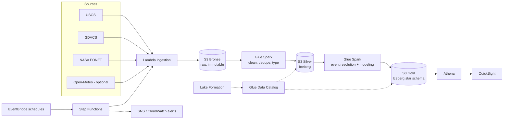

# TerraWatch-Lakehouse

**Multi-source natural hazard analytics on AWS**

> An AWS-native Apache Iceberg lakehouse that ingests multiple public hazard feeds, resolves duplicate real-world events across them, and serves analytics through Athena and QuickSight.

**Status:** 🚧 In progress (see [Roadmap](#roadmap))

---

## Table of contents

1. [Overview](#overview)
2. [Architecture](#architecture)
3. [Data sources](#data-sources)
4. [Data layers](#data-layers)
5. [Data model](#data-model)
6. [Key design decisions](#key-design-decisions)
7. [Results](#results)
8. [Getting started](#getting-started)
9. [Operations](#operations)
10. [Limitations and future work](#limitations-and-future-work)
11. [Roadmap](#roadmap)
12. [Repository structure](#repository-structure)
13. [License and data attribution](#license-and-data-attribution)

---

## Overview

Natural hazard events (earthquakes, floods, cyclones, wildfires, storms) are published by several agencies, each with its own schema, event IDs, update cadence and alert scale. The same real-world event often appears in more than one feed, and records are revised after the fact.

This project builds a lakehouse on AWS services only that:

- ingests multiple feeds on different schedules,
- keeps an immutable raw copy of everything it pulls,
- cleans and standardises the data into Iceberg tables,
- resolves records from different feeds into a single real-world event,
- exposes a dimensional (star schema) model for analytics.

**Goals**

- Demonstrate lakehouse capabilities on S3: ACID upserts, time travel, schema evolution, table maintenance.
- Demonstrate production-style engineering: idempotent incremental loads, data quality checks, failure handling, governance, infrastructure as code and cost controls.

**Non-goals**

- This is not a real-time alerting or emergency-response system. Do not use it for safety decisions.

---

## Architecture

<!-- Replace this Mermaid diagram with an exported image (docs/images/architecture.png) once the design is final, and keep the Mermaid source in docs/. -->



**Services:** S3, Glue (jobs, Data Catalog, Data Quality), Lambda, Step Functions, EventBridge, Athena, QuickSight, Lake Formation, IAM, CloudWatch, SNS.

<!-- Add or remove services to match what you actually use (for example DynamoDB if you store watermarks there). -->

---

## Data sources

| Source                  | Provides                                          | Cadence | Access             |
| ----------------------- | ------------------------------------------------- | ------- | ------------------ |
| USGS Earthquake Hazards | Earthquake events                                 | TBD     | Public API, no key |
| GDACS                   | Floods, cyclones, earthquakes and other alerts    | TBD     | Public API, no key |
| NASA EONET              | Wildfires, severe storms and other natural events | TBD     | Public API, no key |
| Open-Meteo (optional)   | Weather context around events                     | TBD     | Public API         |

<!-- Verify access terms, rate limits and licenses for each source, then fill in the cadence column with what you actually use. -->

---

## Data layers

### Bronze (raw)

- Raw API responses stored exactly as received, never modified.
- Partitioned by source and ingestion date.
- Each pull carries metadata: ingestion timestamp, request parameters, source.

### Silver (cleaned)

- Iceberg tables registered in the Glue Data Catalog.
- Cleaned, typed and deduplicated, one table per source feed.
- Loaded incrementally and idempotently using `MERGE`.
- Data quality rules run before data is promoted. Records that fail go to a quarantine table or alert path. <!-- Describe what you actually implemented. -->

### Gold (curated)

- Iceberg star schema built on resolved events.
- Optimised for Athena and QuickSight queries.

---

## Data model

<!-- Add your ERD image here and list each table with its grain. -->

| Table                        | Grain (one row per...) | Notes                                                   |
| ---------------------------- | ---------------------- | ------------------------------------------------------- |
| `fact_hazard_event`          | TBD                    | TBD                                                     |
| `dim_date`                   | TBD                    | TBD                                                     |
| `dim_location`               | TBD                    | TBD                                                     |
| `dim_hazard_type`            | TBD                    | TBD                                                     |
| `dim_alert_level`            | TBD                    | TBD                                                     |
| `bridge_event_source_record` | TBD                    | Links resolved events to the source records behind them |

### Cross-feed event resolution

<!-- Explain how records from different feeds are matched into one event: matching keys (time window, distance, hazard type), confidence scoring, how conflicts and revisions are handled. -->

---

## Key design decisions

Detailed records live in [`docs/decisions/`](docs/decisions/).

- **Apache Iceberg tables in the Glue Data Catalog** for upserts, time travel and schema evolution.
- **Glue Data Catalog rather than S3 Tables**, keeping the catalog layer explicit and under my control.
- **No Redshift.** The data volume is small and the lake-native design (Athena plus Glue Spark over the same tables) is the point of the project.
- **Athena as the serving layer** with workgroup scan limits for cost control.

<!-- Add more as you make them: watermark approach, partitioning scheme, matching algorithm, IaC tool. -->

---

## Results

<!-- Fill in with measured numbers. Remove any row you do not measure. -->

| Metric                                          | Value |
| ----------------------------------------------- | ----- |
| Raw records ingested (total / per run)          | TBD   |
| Resolved events produced                        | TBD   |
| Duplicate reduction from event resolution       | TBD   |
| Athena data scanned, before vs after compaction | TBD   |
| Athena query time, before vs after compaction   | TBD   |
| Pipeline success rate over N runs               | TBD   |
| Estimated monthly cost                          | TBD   |

**Dashboard preview**

<!-- Add a QuickSight screenshot at docs/images/dashboard.png -->

---

## Getting started

### Prerequisites

- An AWS account with permissions to create the resources above
- AWS CLI configured
- Python 3.x <!-- pin the version you use -->
- Terraform or AWS CDK <!-- keep the one you chose -->

### Deploy

```bash
# TODO: replace with your real commands
git clone https://github.com/<your-username>/terrawatch-lakehouse.git
cd terrawatch-lakehouse

# 1. Configure variables (region, bucket prefix, alert email)
cp .env.example .env   # if you add one

# 2. Deploy infrastructure
# terraform -chdir=infra init && terraform -chdir=infra apply

# 3. Run the first load
# TODO
```

### Configuration

<!-- Table of configurable variables: name, purpose, default. Never commit real keys, account IDs or secrets. -->

### Teardown

```bash
# TODO: how to destroy everything and avoid ongoing cost
```

---

## Operations

- **Scheduling:** EventBridge triggers Step Functions at a cadence per feed.
- **Failure handling:** retries with backoff, catch states and alerts via SNS or CloudWatch alarms.
- **Backfill:** <!-- describe how historical loads differ from incremental runs -->
- **Table maintenance:** scheduled Iceberg compaction and snapshot expiry.
- **Governance:** Lake Formation permissions and least-privilege IAM roles.

See [`docs/runbook.md`](docs/runbook.md) for rerunning failed loads and interpreting alerts.

---

## Limitations and future work

<!-- Be specific and honest. Examples to adapt: -->

- What I would change at 100x the data volume.
- Known gaps in event matching accuracy.
- Possible additions such as streaming ingestion or a warehouse serving layer for high-concurrency dashboards.

---

## Roadmap

- [ ] Repository, infrastructure skeleton, S3 zones, catalog, IAM
- [ ] First end-to-end slice (USGS): ingestion, bronze, silver, idempotent loads
- [ ] Data quality checks and failure handling
- [ ] GDACS and EONET feeds into silver
- [ ] Cross-feed event resolution
- [ ] Gold star schema
- [ ] QuickSight dashboards
- [ ] Lake Formation governance, table maintenance, cost controls
- [ ] Benchmarks, diagrams and write-up

---

## Repository structure

```text
terrawatch-lakehouse/
├── .github/
│   └── workflows/            # CI: terraform fmt/validate, lint, tests
├── infra/
│   ├── bootstrap/            # one-time: S3 bucket for Terraform state
│   ├── modules/
│   │   ├── storage/          # S3 buckets, lifecycle rules, encryption
│   │   ├── catalog/          # Glue databases, Iceberg table definitions
│   │   ├── ingestion/        # Lambda functions, layers, IAM roles
│   │   ├── glue_jobs/        # Glue job definitions, roles
│   │   ├── orchestration/    # Step Functions, EventBridge schedules
│   │   ├── governance/       # Lake Formation permissions, IAM policies
│   │   ├── analytics/        # Athena workgroups with scan limits
│   │   └── monitoring/       # CloudWatch alarms, SNS topics, budgets
│   └── envs/
│       └── dev/              # main.tf, variables.tf, outputs.tf, backend config
├── ingestion/
│   ├── common/               # shared helpers: HTTP retries, watermark, S3 writer
│   ├── usgs/
│   ├── gdacs/
│   └── eonet/
├── transforms/
│   ├── bronze_to_silver/     # Glue jobs, one per source
│   ├── silver_to_gold/       # event resolution + dimensional model
│   ├── maintenance/          # compaction, snapshot expiry
│   └── common/               # shared Spark helpers, schemas, quality rules
├── state_machines/           # Step Functions definitions
├── sql/
│   ├── ddl/                  # table definitions
│   ├── views/                # gold views for QuickSight
│   └── analysis/             # benchmark and exploration queries
├── tests/
│   ├── unit/
│   └── fixtures/
├── samples/                  # real API responses collected while exploring
├── docs/
│   ├── decisions/            # one short record per design choice
│   ├── images/               # architecture diagram, ERD, dashboard screenshots
│   ├── data-dictionary.md
│   └── runbook.md
├── .gitignore
└── README.md
```

<!-- Delete any folder from this tree that you never end up building, so the README matches the repo. -->

---

## License and data attribution

Code is released under the <!-- choose a license, for example MIT --> license.

This project uses data from USGS, GDACS and NASA EONET (and Open-Meteo, if used). Each source has its own terms of use; review and credit them as required before publishing results.
